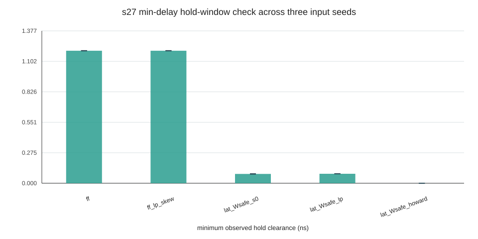

# S27 最小延迟与保持裕量验证报告

## 本阶段目标

在已有 S27 行为级对照仿真的基础上，补充基准文件中的最小路径延迟，并检查数据在锁存器关窗后多久会再次变化。这样可以初步观察保持时间约束对触发器和锁存器方案的影响。

本阶段仍是理论/行为级仿真，没有真实布局布线数据，也没有具体 FPGA 单元的保持时间参数。

## 方法

1. 从 `data/s27.blif.out` 核对每条边的最大、最小延迟；重复边按项目解析器规则分别取最大值和最小值。
2. 用最小延迟运行事件级模型，记录各节点输出变化时间。
3. 对每个目标锁存器，在关窗时刻之后查找每条输入边的下一次数据变化，定义观察到的稳定时间：

   `可用保持时间 = 下一次输入变化时刻 - 锁存器关窗时刻`

4. 在原行为仿真找到的最小可行周期附近检查 5 种方案，并使用 3 组固定随机激励；统计周期 80–159 的捕获窗口。

若指定保持时间 `Th`，该项检查的保持裕量为 `可用保持时间 - Th`。裕量小于 0 时，模型判定为保持失败。

## 结果

表中“最小观察稳定时间”是有限仿真和指定激励下的结果，不是器件保证值。5 种方案的原功能对照在对应周期均通过；3 组激励得到相同的最小值。

| 方案 | 周期 T (ns) | 窗口 W (ns) | 最小观察稳定时间 (ns) | 示例 `Th=0.10 ns` |
| --- | ---: | ---: | ---: | --- |
| `ff` | 6.584 | 0 | 1.19762 | 通过 |
| `ff_lp_skew` | 6.259 | 0 | 1.19762 | 通过 |
| `lat_Wsafe_s0` | 5.059 | 2.5295 | 0.08432 | 失败 |
| `lat_Wsafe_lp` | 5.057 | 2.5285 | 0.08532 | 失败 |
| `lat_Wsafe_howard` | 8.644 | 2.6138 | 0.00002 | 失败 |

锁存器方案中最紧的路径都是 `G7 -> G7`。Howard skew 方案使用的窗口上限 `2.6138 ns` 距该自环的最小延迟 `2.61382 ns` 只有 `0.00002 ns`，所以在当前模型里几乎没有关窗后的稳定余量。LP 方案的最小观察稳定时间约 `0.085 ns`，也低于示例保持时间 `0.10 ns`。

项目工具记录的锁存器保持参数默认值为 `Th=0`。在这个默认条件下，上述动态样本没有观察到负保持裕量；非零保持时间的结果用于敏感性分析，不能解释为某个实际器件一定满足或不满足保持约束。



## 可复现文件

- `sim.py`：支持最大延迟功能仿真和最小延迟保持检查。
- `hold_check.py`：批量运行方案和激励，生成汇总、明细及图表。
- `test_hold.py`：覆盖保持边界、最小延迟映射和仿真接口的 6 项单元测试。
- `results/hold_summary.csv`：各方案最小/最大观察保持稳定时间汇总。
- `results/hold_checks.csv`：每条输入边、捕获周期和随机种子的明细。
- `figures/hold_margin.svg`：三组激励下各方案观察裕量范围。

在 `理论成果/S27行为级验证` 目录中运行：

```powershell
python -m unittest -v test_hold.py
python hold_check.py
python sim.py 5.06 --skew 0.32551 0 0 --hold 0.10
```

## 局限与后续

- 保持分析由有限随机激励驱动，只覆盖本次观察到的数据变化，不是所有路径转换的静态最坏情况分析。
- 模型没有加入真实单元的 setup、hold、clock-to-Q、data-to-Q 参数；当前仓库捕获记录中的这些参数默认均为 0。
- 理想时钟、抽象逻辑和事件级延迟模型不能替代门级仿真、静态时序分析或硅片测量。
- 下一步可在相同模型里联合扫描锁存器透明窗口 `W` 与非零 `Th`，观察 setup 借时收益和 hold 裕量之间的取舍；之后再用可信的单元级参数复核。
