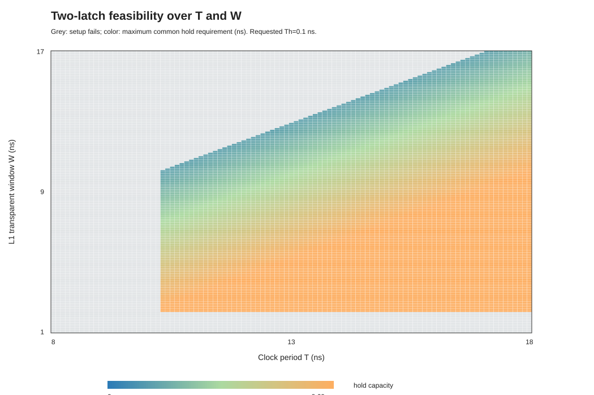

# 双锁存器 T/W/Th 可行域分析报告

## 本阶段问题

上一阶段固定了两级锁存器的分界位置。本阶段把分界改为可调参数，进一步回答：在不同周期 `T` 和 L1 透明窗口 `W` 下，建立时间是否满足，以及两级锁存器最多能容忍多大的共同保持时间要求 `Th`。

这是纯理论模型分析，不涉及真实 FPGA、综合、布局布线或板级测试。

## 模型定义

每个周期中，L1 在 `[nT, nT+W]` 透明，L2 在 `[nT+W, (n+1)T]` 透明，因此 L2 的窗口宽度是 `T-W`。要求 `0 < W < T`。两级锁存器采用相同的保持时间要求 `Th`，用于形成一个清楚的参数边界。

模型判断通过的条件是：

```text
L1 setup slack >= 0
L2 setup slack >= 0
L1 hold slack  >= 0
L2 hold slack  >= 0
```

对满足 setup 的点，最大共同保持时间可以写成：

```text
Th_max(T,W) = min(T + A1min - W, Q1min(W) + d2min)
```

其中 `A1min = tcq_src_min + d1_min`，`Q1min(W)` 是 L1 在最小延迟输入下的输出变化时间。若 `Th <= Th_max`，两级 hold 检查都通过。setup 不通过的点不报告 `Th_max`，避免把 setup 失败时的传播估计误读为有效结果。

## 参数与方法

延迟沿用同级目录 `../两级锁存器理论模型/model.py` 中的演示参数：`d1=1.8/2.0 ns`、`d2=7.8/8.0 ns`（最小/最大），输入源 clock-to-Q 为 `0.05/0.10 ns`，L1 的 data-to-Q 为 `0.04/0.10 ns`、clock-to-Q 为 `0.05/0.12 ns`，setup 为 `0.10 ns`。扫描设置为 `T=8..18 ns`、`W=1..17 ns`，步进均为 `0.1 ns`，共同保持要求为 `Th=0.1 ns`。只保留 `0<W<T` 的点。

脚本对每个 `(T,W)` 计算两级 setup slack 和 hold 容量，并生成 CSV 与 SVG 热图。网格首次通过点受 `0.1 ns` 步进量化，不等同于连续精确边界。

## 结果

| 项目 | 结果 |
| --- | ---: |
| `Th=0.1 ns` 时首次通过周期 | `10.3 ns` |
| 首次通过周期下的最小通过 `W` | `2.2 ns` |
| 首次通过周期下的最大网格通过 `W` | `10.2 ns` |
| 该周期下通过的采样窗口数量 | `81` |
| 有效 `(T,W)` 网格点总数 | `12,075` |
| 示例点 `(T,W)=(10.3,5.15) ns` 的最大共同保持要求 | `7.0 ns` |
| 示例点 `(T,W)=(10.3,10.2) ns` 的最大共同保持要求 | `1.95 ns` |

在默认参数下，第一段路径的 setup 要求给出 `W >= 2.2 ns`；两级 setup 共同要求的最短周期为 `T >= 10.3 ns`。当 `W` 增大时，L1 关窗变晚，L1 的保持时间容量 `T + A1min - W` 会下降。因此 `W` 不是越大越好：窗口太短会让第一级 setup 失败，窗口靠近周期末端时则会压缩 L1 的 hold 裕量。对本次的 `Th=0.1 ns`，在扫描范围内 hold 条件没有把首次通过周期从 `10.3 ns` 推高；但当保持要求提高时，窗口位置可能成为限制因素。

下图中灰色表示 setup 不通过；彩色表示 setup 通过，颜色数值代表该点模型允许的最大共同 `Th`。`W` 接近 `T` 时 L2 窗口很窄，图中仍可能通过，是因为当前模型没有施加锁存器最小脉宽约束。



## 结论与边界

本阶段把“锁存器透明窗口可能改善时序”推进为可比较的二维窗口分配边界和保持时间容限。它可以用来解释 setup 与 hold 如何共同限制窗口分配，也可以作为后续加入非对称保持时间、时钟偏斜或多条路径前的基线模型。

结果仅对当前理想化的两级示例电路和参数成立。模型不包含最小脉宽、时钟抖动、逻辑冒险、亚稳态、多路径竞争、器件库差异等因素；参数不是实测值，也尚未与项目中的 Howard/LP 求解器做数值交叉验证。因此不能据此宣称真实芯片或 FPGA 已通过静态时序验证。

## 产物与复现

- `../两级锁存器理论模型/model.py`：提供时序方程与显式 L1 窗口参数 `window=W`。
- `feasibility.py`：扫描 `T/W/Th` 并生成表格和热图。
- `test_feasibility.py`：检查可行边界、保持容量与扫描摘要。
- `results/feasibility_surface.csv`：逐个 `(T,W)` 的 slack、保持容量和通过状态。
- `results/feasibility_summary.csv`：指定 `Th` 下网格首次通过周期及窗口范围。
- `results/feasibility_map.svg`：setup 可行域与最大保持容量热图。

在本目录运行：

```powershell
py -3.12 -m unittest -v
py -3.12 feasibility.py
```
