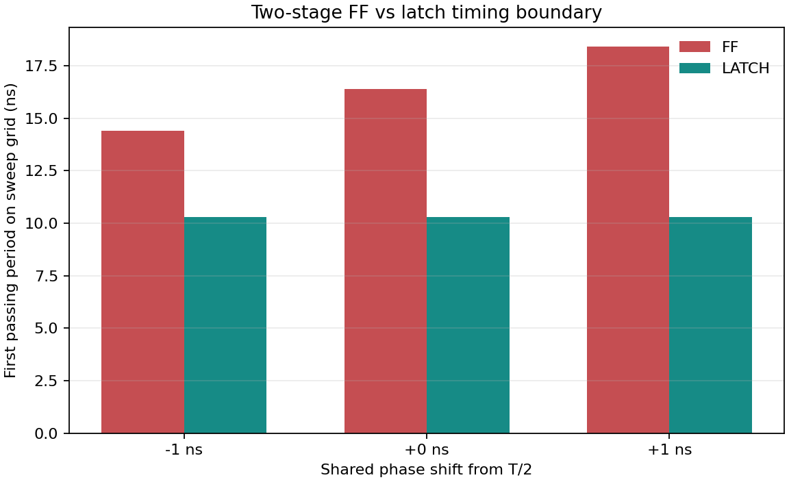
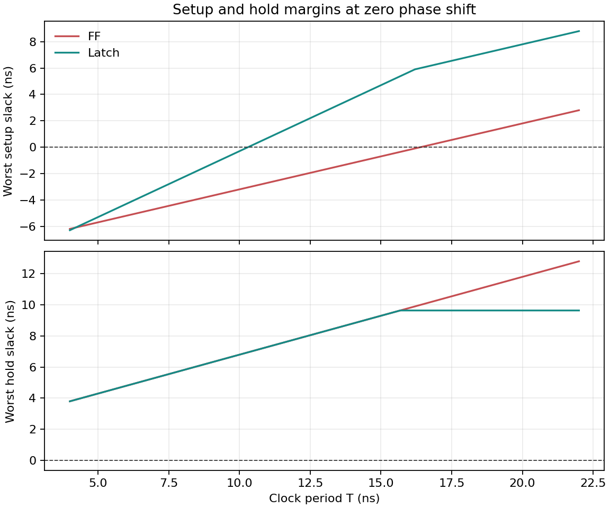
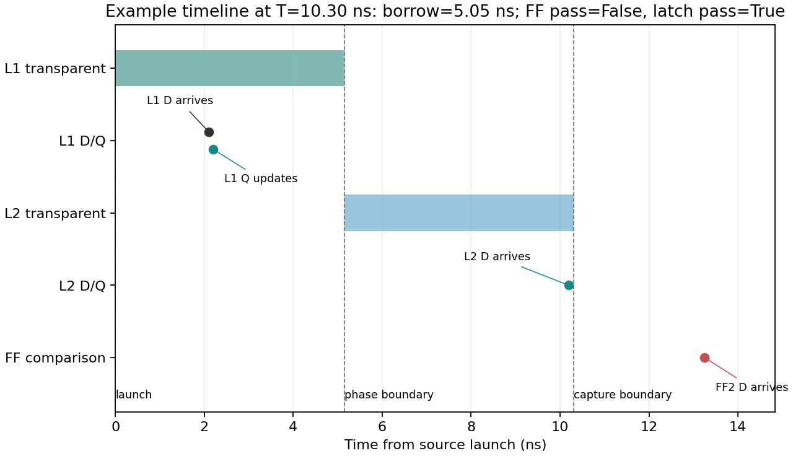

# 双锁存器理论时序验证阶段成果报告

## 一、工作目标

本阶段针对“锁存器的透明窗口能否让晚到的数据继续传播，并改善流水级之间的时序分配”这一问题，建立一个两级小电路的理论时序模型。模型将锁存器实现与使用相同相位边界的触发器实现进行对照，检查建立时间、保持时间和可借用的透明窗口时间。

本工作只研究理论时序，不使用真实 FPGA、布局布线延迟或板级测量数据。

## 二、电路与模型

验证电路由输入源、两段组合逻辑和两级存储单元串联组成：

```text
输入源 -> 逻辑段 d1 -> L1 -> 逻辑段 d2 -> L2 -> 输出
```

输入源每隔一个周期 `T` 发起一次数据变化。锁存器方案中，L1 在周期开始到相位边界之间透明，L2 在相位边界到周期结束之间透明。触发器对照方案在相同的两个相位边界采样，这样可以比较两种存储方式对同一条数据路径的影响。

模型分别使用最大延迟检查建立时间、使用最小延迟检查保持时间。若数据到达 L2 的时间晚于 L2 的打开时刻，但仍早于关闭前的建立时间截止点，这段在 L2 透明期间使用的时间记为“借时量”。

模型默认参数如下，延迟单位均为 ns：

| 参数 | 最大值 | 最小值 |
| --- | ---: | ---: |
| 逻辑段 `d1` | 2.00 | 1.80 |
| 逻辑段 `d2` | 8.00 | 7.80 |
| 输入源时钟到 Q | 0.10 | 0.05 |
| 触发器时钟到 Q | 0.10 | 0.05 |
| L1 数据到 Q | 0.10 | 0.04 |
| L1 时钟到 Q | 0.12 | 0.05 |
| 每级建立时间 | 0.10 | - |
| 每级保持时间 | 0.05 | - |

这些数值是为了让借时现象容易观察而设置的示例参数，不代表某一 FPGA 器件或实际电路的测量结果。

## 三、验证方法

1. 对每个时钟周期和相位偏移分别计算两种实现的 setup/hold 裕量。
2. 当所有检查的裕量均不小于 0 ns 时，判定该周期通过。
3. 逐步扫描周期，记录每种实现首次通过的周期，并生成 CSV 数据和图表。
4. 通过单元测试检查借时、setup 失败、hold 失败和相位参数边界等情况。

本次默认扫描周期范围为 4.00–22.00 ns，步进 0.02 ns；相位偏移分别为 -1 ns、0 ns 和 +1 ns。相位偏移是相对 `T/2` 的共享边界移动量。

## 四、结果

默认参数下得到的首次通过周期如下：

| 相位偏移 | 触发器方案首次通过周期 | 锁存器方案首次通过周期 |
| ---: | ---: | ---: |
| -1 ns | 14.40 ns | 10.30 ns |
| 0 ns | 16.40 ns | 10.30 ns |
| +1 ns | 18.40 ns | 10.30 ns |

在零相位偏移、`T = 10.30 ns` 的示例中，相位边界为 5.15 ns。数据经过 L1 后约在 2.20 ns 到达 L1 输出，经过第二段逻辑后于 10.20 ns 到达 L2。L2 在 5.15 ns 打开，数据在其透明期间继续传播约 5.05 ns，并在关闭前满足 0.10 ns 的 setup 要求。因此锁存器方案通过。

在相同周期下，触发器方案第二级的数据到达时间约为 13.25 ns，晚于 10.30 ns 的采样边界，因此未通过。扫描结果说明：在这组示例参数和模型假设下，锁存器透明窗口允许第二段逻辑使用更多相位时间。

以上周期是 0.02 ns 扫描网格上的首次通过点，属于该理论模型的输出，不是实际电路的最高频率测量值。

### 结果图

不同相位偏移下的周期边界：



建立与保持裕量随周期的变化：



示例周期下的数据到达与透明窗口：



## 五、成果文件

- `model.py`：双锁存器与触发器方案的时序计算模型。
- `sweep.py`：周期和相位扫描脚本，生成 CSV 与结果图。
- `test_model.py`：模型单元测试。
- `README.md`：模型假设、运行命令和参数说明。
- `results/sweep.csv`：每个周期、相位偏移和实现类型的详细结果。
- `results/summary.csv`：各相位偏移下首次通过周期汇总。
- `results/period_boundary.png`：周期边界对比图。
- `results/slack_sweep.png`：建立与保持裕量扫描图。
- `results/timing_trace.png`：数据传播时间线图。

## 六、验证状态与局限

本阶段的 5 项单元测试全部通过，默认周期与相位扫描也成功生成结果文件。运行方法如下，在本目录执行：

```powershell
py -3.12 -m unittest -v
py -3.12 sweep.py
```

当前模型是确定性、周期级的理论时序计算。它只包含一条两级数据路径，并采用固定的 setup/hold 参数；没有模拟逻辑冒险、亚稳态、时钟抖动、脉宽限制或晶体管级行为，也没有使用真实布局布线延迟。默认延迟为演示参数，不能据此声称真实 FPGA 电路已经验证或获得了相同的性能提升。本阶段也尚未将结果与项目中的 Howard/GLPK 求解器做数值交叉验证。

## 七、后续工作

后续可先用项目中已有的可信时序参数替换示例延迟，再增加独立的时钟相位/偏斜参数和多条路径，检查不同参数组合下的 setup/hold 边界。待求解器依赖可用后，再将本模型的通过边界与 Howard/GLPK 输出进行对照。
